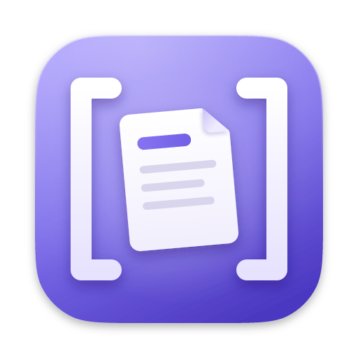
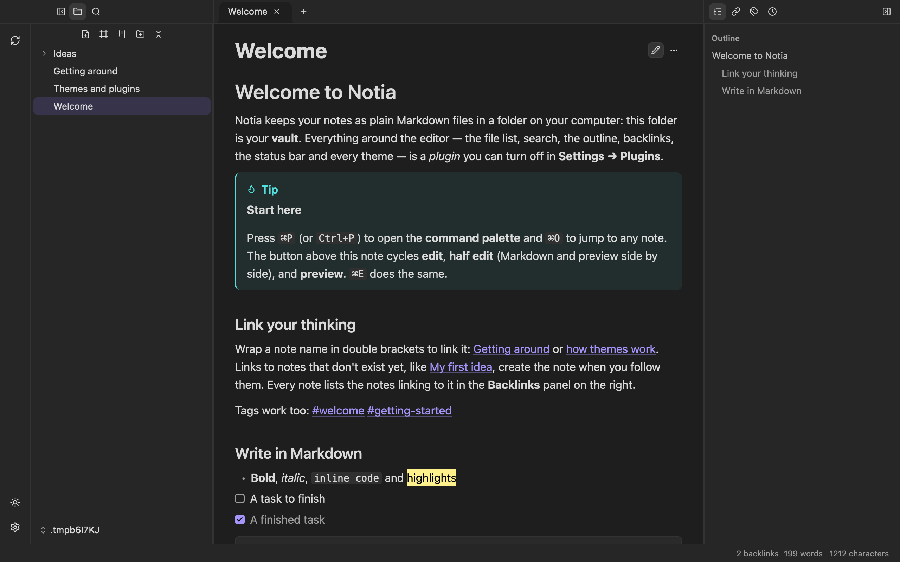
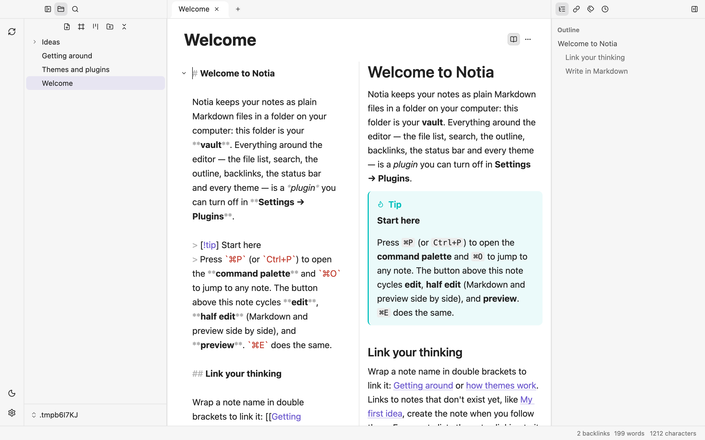
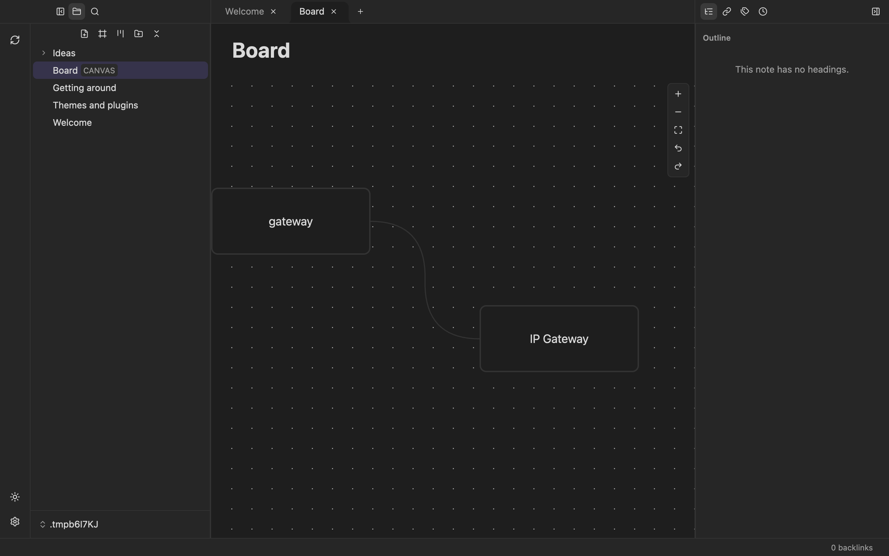
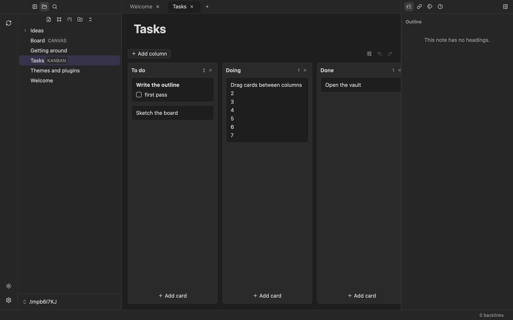

# Notia



Notia is a note-taking app. Notes are plain Markdown files in a folder on your computer, called a vault. The file list, search, history, outline, backlinks, status bar, and themes are plugins, and each one can be turned off.

```
cargo run -p notia
cargo run -p notia -- ~/Notes
```

A folder on the command line opens that vault. Otherwise Notia opens the vault from last time, or asks where a new one should live. An empty vault starts with a few notes that explain the window.



## Build

Notia needs Rust 1.88 or newer. The 2024 edition needs 1.85, and `let` chains in conditions need 1.88.

On Debian and Ubuntu, the GUI libraries are:

```
sudo apt-get install pkg-config libwayland-dev libxkbcommon-dev libxkbcommon-x11-dev libx11-dev libxcb1-dev libvulkan-dev libssl-dev cmake g++ libfontconfig1-dev
```

Release images go to `dist/`:

```
scripts/package.sh              # this operating system
scripts/package.sh macos        # Notia.app inside a .dmg
scripts/package.sh linux        # .tar.gz, and an AppImage when appimagetool is installed
scripts/package.sh windows      # .zip of notia.exe
scripts/package.sh all          # every image this machine can produce
```

A macOS, Windows, or Linux build links that system's libraries, so each image is produced on that system. From macOS or Windows, the Linux image is built in Docker when Docker is running. The Windows image is built by running `scripts/package.sh windows` on Windows. The macOS app requires macOS 12 or newer.

Pushing a version tag builds all three and publishes them as a GitHub release. The tag has to match `version` in `Cargo.toml`, so version `0.1.0` is tag `v0.1.0`.

```
git tag v0.1.0
git push origin v0.1.0
```

The release contains:

| File | System |
| --- | --- |
| `Notia-<version>-macos-<arch>.dmg` | macOS, Apple silicon on the GitHub runner |
| `Notia-<version>-linux-<arch>.tar.gz` | Linux. The binary links the system Wayland, X11, and font libraries |
| `Notia-<version>-windows-<arch>.zip` | Windows |

The macOS app is signed ad hoc, and the Windows executable is unsigned, so the system asks for confirmation before opening them. After copying Notia out of the disk image, macOS may still refuse to open it because the download is quarantined. Clear that attribute, then open the app again:

```
xattr -dr com.apple.quarantine /Applications/Notia.app
```

Running the workflow by hand, without a tag, builds the same images and keeps them as workflow artifacts.

## Phone

The iPhone and iPad app is the same editor. The vault is created in the app's Documents folder, which the Files app can see, and Sync uses the server you already run. Build it on a Mac with Xcode:

```
scripts/package-ios.sh            # dist/Notia.app for the simulator
scripts/package-ios.sh device    # a device build, signed ad hoc
```

A booted simulator gets the app installed. A phone still needs a development team in Xcode before it will launch. The window is one page at a time: Files, the note, and the right-hand panels.

Android cannot use this window. The interface toolkit has no Android backend, so `android/` is a separate app that edits the same Markdown files and talks to the same sync server. It needs the Android SDK, an NDK, and Rust targets `aarch64-linux-android` and `x86_64-linux-android`.

```
scripts/package-android.sh
```

That writes `libnotia_android.so` where Gradle expects it. Open `android/` in Android Studio, or run `./gradlew :app:assembleDebug` from that directory. The phone keeps its vault in the app's private files and asks for the server, token, and vault id. The vault id is the vault folder's name on the computer, unless Settings → Sync sets a different one. The sync token is left out of Android backups.

## Writing

Notes are `.md` files. `[[Getting around]]` links to a note, and `[[Themes and plugins|how themes work]]` shows different text. Following a link to a note that does not exist creates it. `#tags` are indexed. The editor also handles tasks, `==highlights==`, fenced code, and callouts such as `> [!tip]`.

Pasted images are stored in `attachments/`. Deleted files move to `.trash` in the vault. Vault settings, installed themes, and community plugins live in `.notia/`.

The button above a note cycles edit, half edit (Markdown and preview side by side), and preview. `⌘E` does the same.



A Canvas note is a board instead of text: `.canvas` JSON with the same shape Obsidian's Canvas plugin uses. Create one with **Create new canvas** in the command palette, or from the Files panel. Double-click the board to add a box, type in it, drag it, drag from a dot on its side to join two boxes, and press delete or use the buttons above the selection. Scroll pans, and with `⌘` it zooms; the rail at the right edge zooms, fits the whole board, and steps back and forth. Groups, images, and file nodes are Notia's “to do”: boards made in another app keep their boxes and connectors.



A Kanban note is columns of cards, saved as `.kanban` JSON. Create one with **Create new kanban** in the command palette, or from the Files panel. A new board starts with To do, Doing, and Done. Add a card from its column and double-click it to edit. The card is Markdown: Enter finishes it, and Shift+Enter starts a new line. A card shows seven lines, and the rest scrolls inside it. The sliders button sets the column width, the card height, and the space between columns. Drag a card onto another card or column. Delete removes the selected card, and `⌘Z` steps back.



Search accepts `"phrases"`, `tag:#name`, and `path:folder`.

## Keyboard

On Windows and Linux, Ctrl takes the place of `⌘`. Next and previous tab use Ctrl on every system.

| Action | Shortcut |
| --- | --- |
| Command palette | `⌘P` |
| Quick switcher | `⌘O` |
| New note | `⌘N` |
| Save | `⌘S` |
| Close tab | `⌘W` |
| Next tab | `Ctrl+Tab` |
| Previous tab | `Ctrl+Shift+Tab` |
| Edit, half edit, and preview | `⌘E` |
| Search in all files | `⌘⇧F` |
| Change theme | `⌘K` then `⌘T` |
| Toggle the left sidebar | `⌘\` |
| Toggle the right sidebar | `⌘⇧\` |
| Settings | `⌘,` |
| Quit | `⌘Q` |

The command palette lists everything else, including inserting the current date or time. Turn it off, choose which commands are listed, and change shortcuts in **Settings → Command palette**.

## Plugins

Core plugins are Rust and ship with the app. Turn them off in **Settings → Plugins**.

| Plugin | What it adds |
| --- | --- |
| Files | The vault tree: open, create, rename, and delete notes and folders |
| File icons | A folder or file icon beside each item |
| Search | Search across note names and text |
| History | Each saved version of a note. Compare shows the changes, and a version can be restored. Settings chooses how many to keep |
| Outline | Headings of the active note |
| Backlinks | Notes that link here, and the links this note makes |
| Tags | Every tag in the vault |
| Word count | Words and characters in the status bar |
| Date and time | Inserts the current date or time |
| Theme gallery | Nord, Rosé Pine, Catppuccin, and Paper |
| Sync | Syncs the vault with a server you host |

Community plugins are JavaScript, installed like Obsidian's. Each one is a folder in `.notia/plugins`, or a link there to a folder elsewhere, with a `manifest.json` and a `main.js`. Notia lists a plugin from its manifest and loads the code only after you enable it. Turning it off unloads it. Saving its files reloads it, including through a link. The API is in `crates/notia-js/notia.d.ts`, and Notia copies that file to `.notia/plugins/notia.d.ts` for editor completions.

```js
import { Plugin, Notice, ui } from "notia";

export default class Hello extends Plugin {
  async onload() {
    this.settings = { greeting: "Hello!", ...(await this.loadData()) };
    this.addCommand({
      id: "hello",
      name: "Say hello",
      callback: () => new Notice(this.settings.greeting),
    });
    this.addSettingTab({
      render: () => [
        ui.setting("Greeting", ui.textInput(this.settings.greeting, (greeting) => {
          this.settings.greeting = greeting;
          this.saveData(this.settings);
        })),
      ],
    });
  }
}
```

A plugin can add commands, ribbon buttons, status bar items, sidebar panels, bars above the open note, and a page of options in Settings. It can read and write notes, and change the open note through an `Editor` like Obsidian's: `app.workspace.getActiveEditor()`, or the first argument of a command's `editorCallback`.

A plugin is written only against this API, so it can live in a repository of its own. Daily notes does: it opens a note for each day, creating it when needed, and **Open today's daily note** is `⌘⇧T`. Link its folder into a vault and keep a copy of `notia.d.ts` beside its `main.js`:

```
ln -s ~/code/my-plugin ~/Notes/.notia/plugins/my-plugin
```

Rust plugins implement the `Plugin` trait and register through a `PluginContext`. The core plugins in `crates/notia-plugins` are written only against that public API. A Rust plugin's settings page is a `SettingsTab`, and `Notia::save_plugin_data` keeps its values in `.notia/plugin-data`.

## Sync

The Sync plugin copies the vault to a server you run. Notes, images, and every other file sync both ways. Files changed on two computers since the last sync are both kept: the local copy stays, and the other is saved beside it as `Note.sync-conflict-<time>.md`.

Settings, appearance, layout, themes, and plugin data live in `.notia` and sync only when **Include config files** is on. Community plugins, the sync token, and the trash stay on the computer where they are.

```
cargo run -p notia-sync --bin notia-sync-server -- --listen 0.0.0.0:8787
cargo build -p notia-sync --bin notia-sync-server --release
```

The first run writes a token to `notia-sync-data/token` and prints it. In **Settings → Sync**, set the server address, such as `http://192.168.1.20:8787`, and that token. Computers that share a vault use the same vault id. Leave the id empty to use the vault folder's name.

`docker/sync` is a Compose example. Copy `.env.example` to `.env`, set `NOTIA_SYNC_TOKEN`, and run `docker compose up --build -d` from that directory. Vaults are stored in the `sync-data` volume.

The token is the only password. Bind the server to a private network, or put HTTPS in front of it. Notia trusts the certificates of the system it runs on.

## Themes

A theme sets the interface colors, syntax colors, fonts, corner radii, and note typography. The built-in themes are Notia, Nord, Rosé Pine, Catppuccin, and Paper. Pick one in **Settings → Appearance**, or with **Change theme**, which previews each theme as you move through the list.

To add one, put a folder with a `theme.json` (or a single `.json` file) in `.notia/themes`. Notia watches that folder and applies a saved change immediately. A new vault includes an example, Midnight, at `.notia/themes/midnight/theme.json`.

## Layout

| Crate | Role |
| --- | --- |
| `notia` | The application binary |
| `notia-core` | Vault, note parsing, link index, and search. No UI |
| `notia-theme` | Theme files and applying them |
| `notia-plugin` | The plugin API |
| `notia-workspace` | The window: ribbon, sidebars, tabs, palette, and settings |
| `notia-plugins` | The core plugins and bundled themes |
| `notia-sync` | Vault sync, and the server you host |
| `notia-js` | Community plugins, run in QuickJS |

The interface is [GPUI](https://gpui.rs) through [gpui-kit](https://crates.io/crates/gpui-kit).

```
cargo test
cargo test -p notia --test screenshots   # renders the main screens to PNGs; needs a GPU
```

Set `RUST_LOG` to change logging. The default filter is `warn,notia=info`.

## Support

[](https://buymeacoffee.com/chakyiu)

## License

[MIT](LICENSE).
